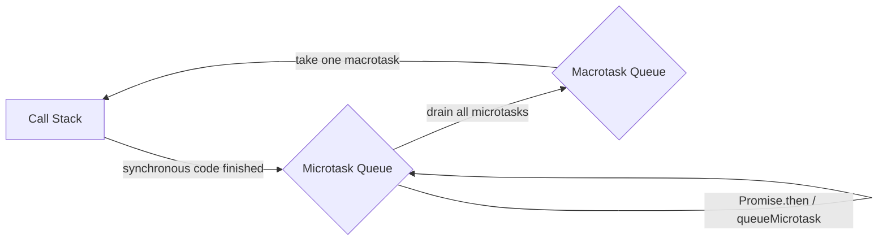

# Asynchronous JavaScript and the Event Loop

JavaScript is single-threaded, yet the event loop lets it handle timers, network requests, and user interaction without blocking the main thread.

## Execution Order at a Glance



Key takeaways:

1. Run all synchronous code first;
2. Then drain **all** microtasks (Promise callbacks, `queueMicrotask`, `MutationObserver`);
3. Then take **one** macrotask (`setTimeout`, event callbacks, I/O), and go back to step 2.

> [!IMPORTANT]
> The browser will not render until the microtask queue is empty. A flood of microtasks can freeze the page.

## A Classic Interview Question

```js
console.log('1');

setTimeout(() => console.log('2'), 0);

Promise.resolve()
  .then(() => console.log('3'))
  .then(() => console.log('4'));

console.log('5');
```

Output order: `1 5 3 4 2`.

- `1` and `5` are synchronous;
- `3` and `4` are microtasks, and each chained `then` queues the next one after the previous finishes;
- `2` is a macrotask and runs last.

## The Essence of async / await

An `async` function returns a Promise, and `await` moves the code after it into a microtask.

```js
async function run() {
  console.log('A');
  await null;          // equivalent to Promise.resolve(null).then(...)
  console.log('B');
}

run();
console.log('C');      // output: A C B
```

Details worth remembering:

| Syntax | Behavior |
| --- | --- |
| `await promise` | Waits for resolution; throws when rejected |
| `await nonPromise` | Wraps it in `Promise.resolve()`, still yielding one microtask |
| `for...of + await` | Runs serially, waiting for each item |
| `Promise.all` | Runs concurrently and rejects on the first failure |

```js
// Serial: about 300ms in total
for (const id of [1, 2, 3]) {
  await fetch(`/api/item/${id}`);
}

// Concurrent: about 100ms in total
await Promise.all([1, 2, 3].map((id) => fetch(`/api/item/${id}`)));
```

> [!TIP]
> Use `Promise.allSettled` when you need every result even if some calls fail; use `Promise.race` when you want whichever settles first.

## Timers Are Not Precise

`setTimeout(fn, 0)` is still queued as a macrotask. It cannot run until the current task and all microtasks finish, and browsers enforce a minimum delay (usually 4ms once nesting exceeds five levels).

```js
let start = performance.now();
setTimeout(() => console.log('elapsed', performance.now() - start), 0);
while (performance.now() - start < 50) { /* block the main thread */ }
// elapsed is roughly 50ms or more
```

## Related Notes

- [Variables and Types](./01-变量与类型.md)
