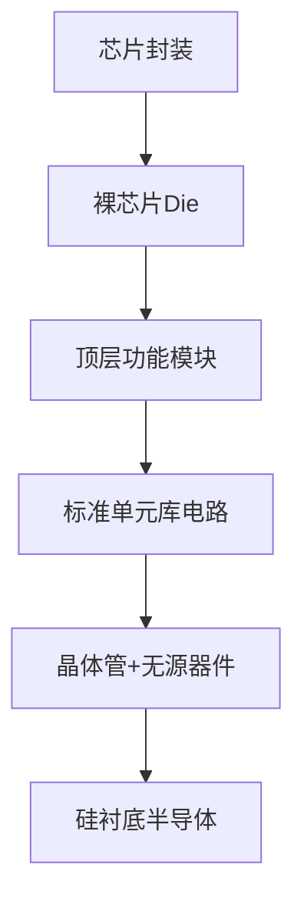

# Chip circuit structure notes

> 
> Description: This article combs the complete hierarchical structure of the chip circuit from macro to micro, distinguishing **architecture levels, circuit modules, transistor bottom layer, interconnection and packaging**, suitable for self-study and review notes

## 1. Overview

The essence of a chip (integrated circuit, IC) is to integrate a large number of micro-transistors, resistors, capacitors and metal connections on a single semiconductor wafer (silicon substrate) through photolithography, doping, deposition and other processes, and combine them according to specific logic to form a micro-circuit system with computing, storage, and signal processing functions.
The chip circuit is not a single circuit, but a structure in which **is layered into**: system architecture layer → functional module layer → standard unit circuit layer → transistor device layer, and then combined with the interconnection layer, IO, and packaging to form a complete usable chip.

## 2. The first layer: the overall partition structure of the bare chip (Die)

The bare chip is the real silicon circuit body inside the package, which is mainly divided into four major areas:

1. **Core functional area (Core)**
The main circuit of the chip, CPU core, GPU computing unit, storage array, DSP, and hardware accelerator are all placed here. It is a concentrated area for large-scale digital/analog circuits.
2. **IO input and output ring (I/O Ring)**
A ring of circuit units surrounding the core area. Contains IO buffer circuit, ESD electrostatic protection circuit, and level conversion circuit.
Function: To realize signal intercommunication between the low-voltage circuit inside the chip and the external PCB board, to withstand external static electricity impact, and to prevent the internal circuit from burning out.
3. **Power Distribution Network PDN (Power Distribution Network)**
Power supply circuit network throughout the Die: power rails, ground rails, decoupling capacitors.
Function: Provide stable power supply to hundreds of millions of transistors and suppress voltage fluctuations (IR voltage drop, power supply noise).
4. **test circuit (DFT, design-for-test)**
Embedded scan chain, boundary scan JTAG circuitry. It is used to detect whether there are short circuits, open circuits, and process defects in chip circuits before leaving the factory.

## 3. Second layer: Function module circuit (Module)

The Core area is composed of several independent functional sub-modules, and different types of chip modules vary greatly:

### Digital chip (MCU/CPU/FPGA) common modules

- control unit: controller, state machine, decoding circuit
- operation unit: ALU arithmetic logic unit, multiplier, adder, shift circuit
- memory circuit: register file, SRAM cache, ROM, flip-flop array
- bus circuit: on-chip bus (AHB/AXI), responsible for data transmission between modules
- clock circuit: PLL phase-locked loop, clock tree (Clock Tree), providing synchronous clock signals to all synchronous circuits

### Analog/mixed signal chip (ADC, power chip) common modules

- amplifier circuit: operational amplifier OPA
- reference source circuit: bandgap reference (Bandgap), generating a stable reference voltage
- comparator, filter circuit, oscillator, charge pump
- ADC: sample and hold circuit + comparison array + decoding logic

> 
Key distinctions between > : **digital circuit handles 0/1 logic; analog circuit handles continuously changing voltage and current**, many chips are digital-analog mixed (SoC).

## Fourth and third layer: Standard cell circuit (Standard Cell)

Inside the module, the EDA tool calls the basic circuit unit in the **standard unit library** to build it.
The standard unit is a small basic circuit designed and verified in advance:

- combinational logic unit: AND gate, OR gate, NOT gate, NAND gate, multiplexer MUX
- sequential logic unit: D flip-flop, latch
- drive unit: Buffer, inverter

> 
All complex digital logic of > can eventually be disassembled into the connections of these basic gate circuits.
> example: an adder = a combination of multiple XOR gates + AND gates.

## 5. The fourth layer: underlying device circuit - transistor (the most basic switch)

The basis of all gate circuits is the **MOS tube (metal-oxide-semiconductor field effect tube)**. Modern CMOS chips use both NMOS + PMOS pairs.

### CMOS inverter (the most basic CMOS circuit)

- PMOS: Connect to VDD power supply
- NMOS: connect GND Ground
- share the same input and output
Principle:
Input high level → NMOS turns on, PMOS turns off → output low level
Input low level → PMOS turns on, NMOS turns off → output high level

Countless CMOS tubes are paired in pairs to form various logic gates, which are then assembled into units and modules.

> 
> Note: The transistor itself is the **semiconductor device**, which is the smallest active device in the circuit; the chip will also integrate passive devices: polysilicon resistors and MIM capacitors.

## 6. Interconnection layer: metal wiring structure (multi-layer wiring)

The transistor is made on the surface of the silicon substrate, and multiple layers of metal are stacked on the upper layer to connect the various devices, which is what we often call the metal layer (Metal Layer):

1. bottom metal (M1/M2): thin wire, connected to the internal transistors of the same standard unit
2. mid-layer metal: medium line width, interconnection between units
3. top layer thick metal: thick wires, used for global power supply and clock trunk lines, lower resistance
The metal layers are opened with **through holes (Via)** to achieve cross-layer connections.

> 
The > advanced process (7nm/3nm) metal layer can have more than 10 layers, and the wiring resources directly determine whether the chip can be routed and whether the timing is good.

## 7. Clock tree circuit (key structure of synchronous digital chip)

The vast majority of digital chips are synchronous sequential circuits that rely on a unified clock to drive flip-flops.
The clock tree is a special wiring circuit: starting from the PLL clock source, passing through multi-level buffer branches, the clock signal is sent to each flip-flop, trying to ensure that the clocks arrive at the same time (reduce clock skew).
Clock tree power consumption often accounts for a large proportion of the total chip power consumption, and is a key optimization target in chip design.

## 8. From Die to Package: External Circuit Interface

The die itself is fragile and requires packaging:

- Pad: Die edge metal block, connected to package pins through gold/copper wires or bumps (Bump)
- package substrate: internal wiring, connecting pad to external Pin pin
- pin: finally welded on the PCB circuit board and connected to the board-level circuit

> 
> chip circuit ≠ Only the internal circuit of the silicon chip; package interconnection and PCB board-level circuit are extensions of the entire system circuit.

## 9. Supplement: Comparison of circuit architectures of two types of chips

table

| Type | Circuit structure characteristics |
| --- | --- |
| ASIC special chip | Fully customized circuit layout, fixed module, cannot be modified |
| FPGA | A large number of configurable logic units CLB + programmable interconnect matrix, circuit connections can be reconfigured at power on |

## 10. Summarize the hierarchical relationship in one sentence

**silicon substrate → MOS transistor → CMOS gate circuit (standard unit) → functional module → core circuit + IO/PDN/DFT → bare die → packaged chip**
The essence of chip circuits is to use transistors as electronically controlled switches and build large-scale logic and analog networks through hierarchical interconnections to achieve signal calculation, storage and control.
