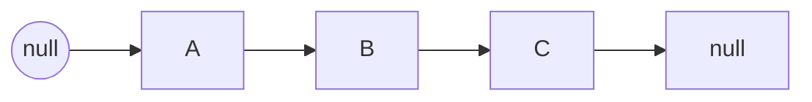

# Arrays and Linked Lists

Arrays and linked lists are the two most fundamental linear structures. Almost every difference between them comes from one fact: **arrays are contiguous in memory, linked lists are not**.

## Complexity Comparison

| Operation | Array | Linked List |
| --- | --- | --- |
| Access by index | $O(1)$ | $O(n)$ |
| Insert / delete at head | $O(n)$ | $O(1)$ |
| Insert at tail | Amortized $O(1)$ | $O(1)$ (with a tail pointer) |
| Insert / delete in the middle | $O(n)$ | $O(n)$ to find + $O(1)$ to relink |
| Cache friendliness | High | Low |

Given a reference to a node, insertion and deletion in a linked list are $O(1)$; the cost is that you must first walk to that node.

> [!NOTE]
> Dynamic arrays usually grow by doubling. Amortized over all insertions the cost is still $O(1)$:
> $$T(n) = \frac{1 + 2 + 4 + \cdots + n}{n} < \frac{2n}{n} = 2$$

## Typical Array Techniques

```js
const arr = [1, 2, 3, 4, 5];

// Two pointers: reverse in place
function reverse(nums) {
  let left = 0;
  let right = nums.length - 1;
  while (left < right) {
    [nums[left], nums[right]] = [nums[right], nums[left]];
    left += 1;
    right -= 1;
  }
  return nums;
}

// Sliding window: length of the longest substring without repeats
function longestUnique(s) {
  const seen = new Map();
  let start = 0;
  let best = 0;
  for (let i = 0; i < s.length; i++) {
    if (seen.has(s[i]) && seen.get(s[i]) >= start) {
      start = seen.get(s[i]) + 1;
    }
    seen.set(s[i], i);
    best = Math.max(best, i - start + 1);
  }
  return best;
}
```

## Typical Linked List Techniques

```js
class ListNode {
  constructor(value, next = null) {
    this.value = value;
    this.next = next;
  }
}

// Iteratively reverse a singly linked list
function reverseList(head) {
  let prev = null;
  let cur = head;
  while (cur) {
    const next = cur.next;
    cur.next = prev;
    prev = cur;
    cur = next;
  }
  return prev;
}
```

The reversal can be drawn as a pointer diagram:



> [!WARNING]
> A common mistake in linked-list problems is changing `cur.next` before saving `next`, which breaks the list. Always save the successor pointer first.

## Which One Should You Use?

- **Read-heavy workloads that need random access**: arrays (the default choice for most applications);
- **Frequent insertion or deletion at the head, with unpredictable size**: linked lists;
- **Fast index lookup plus frequent deletion**: consider an array with lazy deletion, or a skip list;
- **In real projects**: prefer the language's built-in dynamic array (`Array` in JS, `ArrayList` in Java); linked lists mostly appear in algorithm problems and low-level implementations.

## Related Notes

- [Variables and Types](../../前端/JavaScript/01-变量与类型.md)
