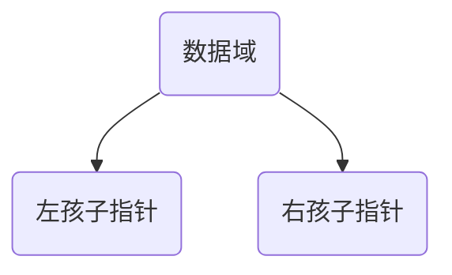

# Data structure - tree

## 1. Basic concept of tree
Tree is a **nonlinear** data structure, used to express one-to-many hierarchical relationships.
Linear structure (linked list, stack, queue): one-to-one; tree: one-to-many; graph: many-to-many.

### 1. Basic terminology
- **Root node (Root)**: The top node of the tree, no predecessor. A tree has one and only one root.
- **node**: stores data + branches pointing to child nodes.
- **child node / child (Child)**: A node connected downwards.
- **parent node / parent (Parent)**: the upper node of the child node.
- **Sibling node (Sibling)**: All child nodes under the same parent node are brothers of each other.
- **Leaf node (Leaf)**: Node without child nodes, terminal node.
- **Branch node (non-leaf)**: has at least one child node.
- **subtree (Subtree)**: A tree composed of a node and all its descendants.
- **degree (Degree)**: the number of **child nodes a node has**; degree of the tree: the maximum value of the degrees of all nodes.
- **Depth (Depth)**: The number of layers passed from the root to the node. Root depth is generally defined as 1 (some textbooks define it as 0, please refer to the description of the question).
- **Height (Height)**: The number of layers from the node downward to the farthest leaf; the height of the tree = the height of the root node.
- **Number of layers**: The root is the 1st layer, increasing downwards in sequence.
- **Forest**: A collection of several disjoint trees. A tree becomes a forest by deleting its root; a forest becomes a tree by adding a common root.

Characteristics of the > tree:
> 1. There is only one root node
> 2. Except for the root, each node has only one parent node.
> 3. There is only one path between any two nodes.
> 4. There is no ring (there is a ring in the picture)

## 2. Binary tree (key points)
Binary Tree: The degree of the tree is ≤ 2, and the child nodes **are divided into left and right children. The order cannot be reversed.** is divided into left children and right children.
> Note: Binary trees are not trees with a maximum degree of 2! The children of ordinary trees do not distinguish left and right subtrees, while binary trees strictly distinguish between left and right subtrees.

### 1. Five basic forms of binary trees
1. empty binary tree
2. only has the root node
3. root + left subtree
4. root + right subtree
5. root + left subtree + right subtree

### 2. Two special binary trees
#### (1) full binary tree
The maximum number of nodes is reached at each level, and all leaves are at the last level.
A full binary tree with height $h$, total number of nodes: $2^h -1$.

#### (2) complete binary tree
Numbered in sequence from top to bottom and from left to right.
The $h-1$ layer before - is full;
- The last layer of nodes is arranged continuously on the left, and vacancies are allowed on the right;
- A full binary tree must be a complete binary tree, but a complete binary tree is not necessarily a full binary tree.

Properties of > complete binary tree: It is suitable to use **array to store** sequentially, and the heap is a complete binary tree.

### 3. Important properties of binary trees (frequent exam)
Assume: $n$ is the total number of nodes, $n_0$ is the number of leaves, $n_1$ degree is 1 node, $n_2$ degree is 2 nodes
1. $n = n_0 + n_1 + n_2$
2. **$n_0 = n_2 + 1$** (the core formula: number of leaf nodes = number of degree 2 nodes + 1)
The $i$ layer of 3. has at most $2^{i-1}$ nodes (i≥1)
4. Binary tree with height $h$, up to $2^h -1$ nodes
Complete binary tree of 5. $n$ nodes, height: $\lfloor \log_2n \rfloor +1$

Complete binary tree array numbering properties (subscripts start from 1):
The left child of - node $i$: $2i$
Right child of node - : $i$: $\(2i+1\)$
The parent node of - node $i$: $\lfloor i/2 \rfloor$

> If the array subscript starts from 0:
> - Left child: $\(2i+1\)$
> - Right child: $\(2i+2\)$
> - Parent node: $\lfloor (i-1)/2 \rfloor$

## 3. Storage of binary trees
### 1. Sequential storage (array)
Suitable for **complete binary tree and full binary tree**; ordinary sparse binary trees will waste a lot of space.
- rule: The layers are filled in the array in sequence, and the vacant positions must also be occupied.

### 2. Linked storage (binary linked list, most commonly used)
Node structure:

- data: data field
- lchild: left child pointer
- rchild: right child pointer

C language pseudo structure:
```c
typedef struct BiTNode{
    int data;
    struct BiTNode *lchild, *rchild;
}BiTNode, *BiTree;
```
 expansion: three-pronged linked list, adding parent pointer to facilitate upward traversal.

## 4. Binary tree traversal (required test)
Traversal: Visit each node in the tree according to rules and only once.
> distinguishes between: visiting nodes (outputting/processing data) and recursively traversing subtrees.

Divided by root node access location:
1. **Preorder traversal (root → left → right)**: visit the root first, then the left subtree, then the right subtree
2. **In-order traversal (left → root → right)**: First left subtree, visit the root, then right subtree ✅ Binary search tree in-order is an ascending sequence
3. **Post-order traversal (left → right → root)**: first left, then right, and finally visit the root
4. **layer-sequential traversal**: from top to bottom by layer, from left to right on the same layer, implemented with the help of queues

> memory formula: the front root is the beginning, the middle root is the middle, and the back root is the tail; the left is always in front of the right.
> question type: Given two traversal sequences, restore the binary tree
> ✅ Preorder + midorder, postorder + midorder can uniquely determine a binary tree
> ❌ Preorder + Postorder cannot be uniquely determined

Recursive template (pseudocode)
```
前序：
visit(root)
preOrder(root->lchild)
preOrder(root->rchild)

中序：
inOrder(root->lchild)
visit(root)
inOrder(root->rchild)

后序：
postOrder(root->lchild)
postOrder(root->rchild)
visit(root)
```

Non-recursive traversal: use stack to simulate recursion; use queue for layer sequence.

## 5. Binary Search Tree BST (Binary Search Tree)
Binary search tree, also called binary sorting tree.
Rules:
All node values on the left subtree of - < root node value
All node values on the right subtree of - > root node value
The left and right subtrees of - are also BST
- default: Duplicate values are generally not allowed (when the question description can be repeated, the duplicates are placed on the left or right)

Features: The result of **in-order traversal is the increasing ordered sequence**.
Operation: search, insert, delete.
- search: similar to binary search, degenerating into a single chain (O(n)) at worst; O(logn) at equilibrium
- deletion can be divided into three situations: leaf / only one child / both left and right children (generally replaced by mid-order predecessor/successor)

## 6. Balanced Binary Tree AVL
AVL tree: Self-balancing binary search tree.
Balance factor BF = left subtree height − right subtree height
Regulations: **BF ∈ {-1, 0, 1}**, if it exceeds, it must be rotated and adjusted.
Rotation types: LL, RR, LR, RL four rotations.
Purpose: To prevent BST from degenerating into a linked list and ensure a stable search complexity of O(logn).

> extension: Red-black tree is also a balanced BST. The balance conditions are looser than AVL, there are fewer insertions, deletions and rotations, and it is more commonly used in projects (C++ map, Java TreeMap bottom layer).

## 7. Heap
The heap is a **complete binary tree**, which is divided into a big top heap and a small top heap, and is generally stored in an array.
- big top heap: parent node ≥ left and right children, the top of the heap is the maximum value
- small top heap: parent node ≤ left and right children, the top of the heap is the minimum value

Core operations:
- builds a pile, adjusts upward (floating), adjusts downward (sinking)
Application: Heap sorting, priority queue (PriorityQueue), TopK problem.

> Note: The heap only guarantees the size relationship between the parent and the child, **does not guarantee ordering**; only the heap sort output result is in order.

## 8. Huffman tree (Huffman tree/optimal binary tree)
Weighted path length WPL: the sum of all leaf nodes (weight × path length).
Huffman tree: Given a set of weights, construct a WPL minimal binary tree.

Construction steps:
1. puts all values into the collection as independent leaf nodes
2. Select the two nodes with the smallest weights and create a new parent node. The weight = the sum of the two nodes.
3. Put the new node back into the set and repeat step 2 until only one tree remains

Properties:
1. Huffman tree **has no node** with degree 1, only leaves and nodes with degree 2
Huffman tree with 2. n leaves, total number of nodes: $2n-1$
3. Huffman coding: left 0 and right 1, leaf path as coding, prefix coding (any coding is not the prefix of other coding, no ambiguity)
Application: File compression.


## 9. Summary of common comparisons
| Structure | Features | Find |
| ---- | ---- | ---- |
| Ordinary tree | One-to-many, children are disordered | - |
| Binary tree | Up to two children, distinguish left and right | Depend on the shape |
| BST | Small on the left and large on the right, middle order | Worst O(n) |
| AVL | BST+balance factor, strictly balanced | O(logn) |
| Red-black tree | Approximately balanced, less rotation | O(logn) |
| Heap | Complete binary tree, parent-child size constraint | Take the maximum value O(1) |
| Huffman tree | WPL is the smallest, used for encoding compression | - |


---
