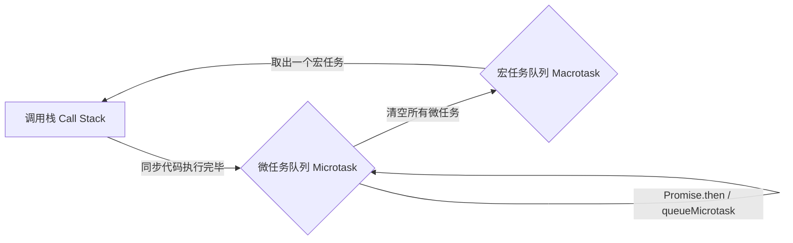

# 异步与事件循环

JavaScript 是单线程语言，但借助事件循环（Event Loop）可以处理定时器、网络请求和用户交互，而不会阻塞主线程。

## 一张图看懂执行顺序



关键结论：

1. 先执行完同步代码；
2. 再清空**所有**微任务（Promise 回调、`queueMicrotask`、`MutationObserver`）；
3. 然后取出**一个**宏任务（`setTimeout`、事件回调、I/O）执行，回到第 2 步。

> [!IMPORTANT]
> 微任务队列清空之前，浏览器不会进行渲染。大量微任务会卡住页面。

## 经典面试题

```js
console.log('1');

setTimeout(() => console.log('2'), 0);

Promise.resolve()
  .then(() => console.log('3'))
  .then(() => console.log('4'));

console.log('5');
```

输出顺序：`1 5 3 4 2`。

- `1`、`5` 是同步代码；
- `3`、`4` 属于微任务，且链式 `then` 会在上一轮完成后继续排队；
- `2` 是宏任务，最后执行。

## async / await 的本质

`async` 函数返回 Promise，`await` 会把后面的代码放进微任务。

```js
async function run() {
  console.log('A');
  await null;          // 等价于 Promise.resolve(null).then(...)
  console.log('B');
}

run();
console.log('C');      // 输出：A C B
```

需要注意的细节：

| 写法 | 行为 |
| --- | --- |
| `await promise` | 等待 resolve，失败时抛出异常 |
| `await nonPromise` | 用 `Promise.resolve()` 包一层，仍然让出一次微任务 |
| `for...of + await` | 串行执行，等待上一项完成 |
| `Promise.all` | 并发执行，任一失败即 reject |

```js
// 串行：总耗时 300ms
for (const id of [1, 2, 3]) {
  await fetch(`/api/item/${id}`);
}

// 并发：总耗时约 100ms
await Promise.all([1, 2, 3].map((id) => fetch(`/api/item/${id}`)));
```

> [!TIP]
> 需要「即使部分失败也拿到全部结果」时用 `Promise.allSettled`；需要「谁先完成用谁」时用 `Promise.race`。

## 定时器并不精确

`setTimeout(fn, 0)` 实际会被排到宏任务队列，最快也要等当前任务和微任务结束，而且浏览器有最小延迟限制（嵌套超过 5 层时通常为 4ms）。

```js
let start = performance.now();
setTimeout(() => console.log('elapsed', performance.now() - start), 0);
while (performance.now() - start < 50) { /* 阻塞主线程 */ }
// elapsed 约 50ms 以上
```

## 相关笔记

- [变量与类型](./01-变量与类型.md)
