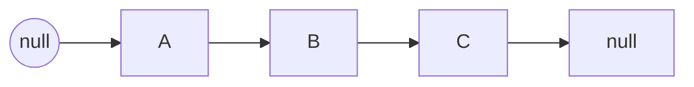

# 数组与链表

数组和链表是最基础的两种线性结构。它们的差异几乎全部来自同一个事实：**数组在内存中连续，链表不连续**。

## 复杂度对比

| 操作 | 数组 | 链表 |
| --- | --- | --- |
| 按下标访问 | $O(1)$ | $O(n)$ |
| 头部插入 / 删除 | $O(n)$ | $O(1)$ |
| 尾部插入 | 均摊 $O(1)$ | $O(1)$（维护尾指针） |
| 中间插入 / 删除 | $O(n)$ | $O(n)$ 查找 + $O(1)$ 修改 |
| 缓存友好度 | 高 | 低 |

链表在「已知节点」的前提下插入删除是 $O(1)$，代价是必须先走到那个节点。

> [!NOTE]
> 动态数组扩容通常是翻倍策略。均摊到每次插入，复杂度仍是 $O(1)$：
> $$T(n) = \frac{1 + 2 + 4 + \cdots + n}{n} < \frac{2n}{n} = 2$$

## 数组的典型写法

```js
const arr = [1, 2, 3, 4, 5];

// 双指针：原地反转
function reverse(nums) {
  let left = 0;
  let right = nums.length - 1;
  while (left < right) {
    [nums[left], nums[right]] = [nums[right], nums[left]];
    left += 1;
    right -= 1;
  }
  return nums;
}

// 滑动窗口：最长无重复子串长度
function longestUnique(s) {
  const seen = new Map();
  let start = 0;
  let best = 0;
  for (let i = 0; i < s.length; i++) {
    if (seen.has(s[i]) && seen.get(s[i]) >= start) {
      start = seen.get(s[i]) + 1;
    }
    seen.set(s[i], i);
    best = Math.max(best, i - start + 1);
  }
  return best;
}
```

## 链表的典型写法

```js
class ListNode {
  constructor(value, next = null) {
    this.value = value;
    this.next = next;
  }
}

// 迭代反转单链表
function reverseList(head) {
  let prev = null;
  let cur = head;
  while (cur) {
    const next = cur.next;
    cur.next = prev;
    prev = cur;
    cur = next;
  }
  return prev;
}
```

反转过程可以画成指针图：



> [!WARNING]
> 链表题里的常见错误是「先修改 `cur.next` 再保存 `next`」，导致链表断裂。永远先保存后继指针。

## 什么时候用哪个

- **读多写少、需要随机访问**：数组（绝大多数业务的默认选择）；
- **频繁在头部插入删除、数据量不可预知**：链表；
- **需要按下标快速定位又要频繁删除**：考虑「数组 + 懒删除」或跳表；
- **实际工程中**：优先用语言内置的动态数组（JS 的 `Array`、Java 的 `ArrayList`），链表更多出现在算法题与底层实现里。

## 相关笔记

- [变量与类型](../../前端/JavaScript/01-变量与类型.md)
