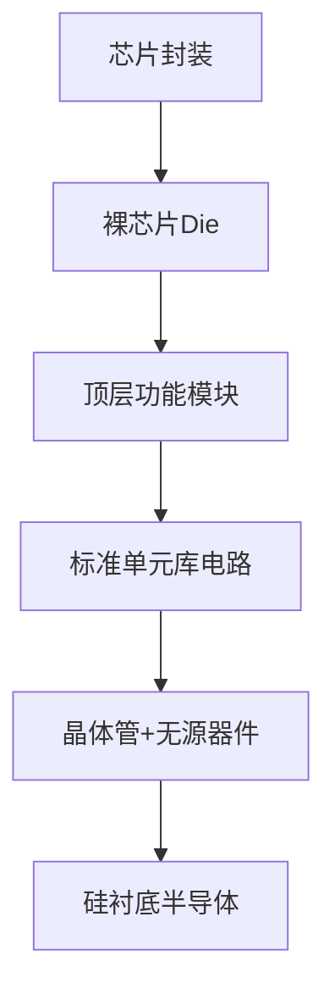

# 芯片电路结构笔记

> 
> 说明：本文从宏观到微观梳理芯片电路完整层级结构，区分**架构层级、电路模块、晶体管底层、互连与封装**，适合自学、复习笔记使用

## 一、总述

芯片（集成电路，IC）本质是在单块半导体晶圆（硅基底）上，通过光刻、掺杂、沉积等工艺，集成海量微型晶体管、电阻、电容以及金属连线，按特定逻辑组合形成具备计算、存储、信号处理功能的微型电路系统。
芯片电路不是单一电路，而是**分层嵌套**的结构：系统架构层 → 功能模块层 → 标准单元电路层 → 晶体管器件层，再配合互连层、IO、封装形成完整可用芯片。

## 二、第一层：裸片（Die）整体分区结构

裸片是封装内部真正的硅片电路本体，主要分为四大区域：

1. **核心功能区（Core）**
芯片主体电路，CPU 核、GPU 计算单元、存储阵列、DSP、硬件加速器都放在这里，是大规模数字 / 模拟电路集中区域。
2. **IO 输入输出环（I/O Ring）**
环绕在核心区四周的一圈电路单元。包含 IO 缓冲电路、ESD 静电保护电路、电平转换电路。
作用：实现芯片内部低压电路和外部 PCB 板的信号互通，承受外部静电冲击，防止内部电路烧毁。
3. **电源分布网络 PDN（Power Distribution Network）**
遍布整个 Die 的供电电路网络：电源轨、地轨、去耦电容。
作用：给上亿个晶体管稳定供电，抑制电压波动（IR 压降、电源噪声）。
4. **测试电路（DFT，可测试设计）**
内嵌扫描链、边界扫描 JTAG 电路。出厂用来检测芯片电路是否存在短路、开路、工艺缺陷。

## 三、第二层：功能模块电路（Module）

Core 区域由若干独立功能子模块拼接而成，不同类型芯片模块差异很大：

### 数字芯片（MCU/CPU/FPGA）常见模块

- 控制单元：控制器、状态机、译码电路
- 运算单元：ALU 算术逻辑单元、乘法器、加法器、移位电路
- 存储电路：寄存器堆、SRAM 缓存、ROM、触发器阵列
- 总线电路：片上总线（AHB/AXI），负责模块之间数据传输
- 时钟电路：PLL 锁相环、时钟树（Clock Tree），给所有同步电路提供同步时钟信号

### 模拟 / 混合信号芯片（ADC、电源芯片）常见模块

- 放大器电路：运算放大器 OPA
- 基准源电路：带隙基准（Bandgap），产生稳定参考电压
- 比较器、滤波电路、振荡器、电荷泵
- ADC：采样保持电路 + 比较阵列 + 译码逻辑

> 
> 重点区分：**数字电路处理 0/1 逻辑；模拟电路处理连续变化电压电流**，很多芯片是数模混合（SoC）。

## 四、第三层：标准单元电路（Standard Cell）

模块内部，由 EDA 工具调用**标准单元库**里面的基础电路单元搭建。
标准单元是提前设计、验证好的小型基础电路：

- 组合逻辑单元：与门 AND、或门 OR、非门 NOT、与非门 NAND、多路选择器 MUX
- 时序逻辑单元：D 触发器、锁存器
- 驱动单元：缓冲器 Buffer、反相器

> 
> 所有复杂数字逻辑，最终都可以拆解成这些基础门电路的连接。
> 例：一个加法器 = 多个异或门 + 与门组合。

## 五、第四层：底层器件电路 —— 晶体管（最基础开关）

所有门电路的基础是**MOS 管（金属 - 氧化物 - 半导体场效应管）**，现代 CMOS 芯片同时使用 NMOS + PMOS 配对。

### CMOS 反相器（最基础 CMOS 电路）

- PMOS：接 VDD 电源
- NMOS：接 GND 地
- 共用同一个输入、同一个输出
原理：
输入高电平 → NMOS 导通、PMOS 截止 → 输出低电平
输入低电平 → PMOS 导通、NMOS 截止 → 输出高电平

由无数 CMOS 管，两两配对构成各种逻辑门，再向上组装成单元、模块。

> 
> 注意：晶体管本身是**半导体器件**，属于电路的最小有源器件；芯片里也会集成无源器件：多晶硅电阻、MIM 电容。

## 六、互连层：金属连线结构（多层布线）

晶体管做在硅基底表面，上层堆叠多层金属，用来连接各个器件，也就是我们常说的金属层（Metal Layer）：

1. 底层金属（M1/M2）：细线，连接同一个标准单元内部晶体管
2. 中层金属：中等线宽，单元之间互连
3. 顶层厚金属：粗线，用于全局电源、时钟主干线，电阻更低
金属层之间用**通孔（Via）**打通，实现跨层连接。

> 
> 先进工艺（7nm/3nm）金属层可以多达 10 层以上，布线资源直接决定芯片能不能布通、时序好不好。

## 七、时钟树电路（同步数字芯片关键结构）

绝大多数数字芯片是同步时序电路，依靠统一时钟驱动触发器。
时钟树是一种特殊布线电路：从 PLL 时钟源出发，经过多级缓冲分支，把时钟信号送到每一个触发器，尽量保证时钟同时到达（降低时钟偏斜 skew）。
时钟树功耗往往占芯片总功耗很大比例，是芯片设计重点优化对象。

## 八、从 Die 到封装：外部电路接口

裸片本身很脆弱，需要封装：

- 焊盘（Pad）：Die 边缘金属块，通过金丝 / 铜丝或者凸块（Bump）连接到封装引脚
- 封装基板：内部走线，连接焊盘到外部 Pin 引脚
- 引脚：最终焊接在 PCB 电路板上，和板级电路相连

> 
> 芯片电路 ≠ 只有硅片内部电路；封装互连、PCB 板级电路是整个系统电路的延伸。

## 九、补充：两类芯片电路架构对比

表格

| 类型 | 电路结构特点 |
| --- | --- |
| ASIC 专用芯片 | 全定制电路布局，模块固定，不可修改 |
| FPGA | 大量可配置逻辑单元 CLB + 可编程互连矩阵，电路连接可以上电重新配置 |

## 十、一句话总结层级关系

**硅衬底 → MOS 晶体管 → CMOS 门电路（标准单元） → 功能模块 → 核心电路 + IO/PDN/DFT → 裸 Die → 封装芯片**
芯片电路本质是：用晶体管作为电控开关，通过分层互连，搭建大规模逻辑与模拟网络，实现信号运算、存储与控制。