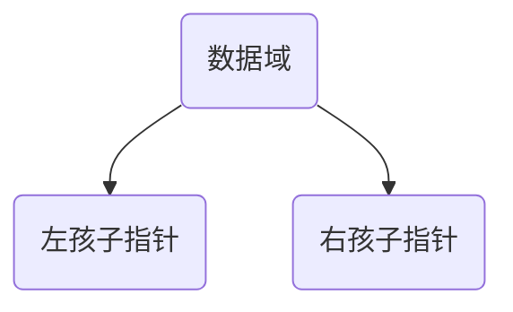

# 数据结构 - 树

## 一、树的基本概念
树（Tree）是**非线性**的数据结构，用来表达一对多的层次关系。
线性结构（链表、栈、队列）：一对一；树：一对多；图：多对多。

### 1. 基础术语
- **根节点（Root）**：树最顶层节点，没有前驱。一棵树有且只有一个根。
- **节点**：存储数据 + 指向子节点的分支。
- **子节点 / 孩子（Child）**：一个节点向下连接的节点。
- **父节点 / 双亲（Parent）**：子节点的上层节点。
- **兄弟节点（Sibling）**：同一个父节点下的所有子节点互为兄弟。
- **叶子节点（Leaf）**：没有子节点的节点，终端节点。
- **分支节点（非叶子）**：至少有一个子节点。
- **子树（Subtree）**：某个节点和它所有后代构成的树。
- **度（Degree）**：一个节点拥有**子节点的个数**；树的度：所有节点度的最大值。
- **深度（Depth）**：从根到该节点经过的层数。根深度一般定义为 1（部分教材定义为0，做题看题目说明）。
- **高度（Height）**：从该节点往下，到最远叶子的层数；树的高度 = 根节点的高度。
- **层数**：根为第1层，依次向下递增。
- **森林（Forest）**：若干棵互不相交的树组成的集合。树删去根就变成森林；森林加一个公共根变回树。

> 树的特点：
> 1. 有且仅有一个根节点
> 2. 除根外每个节点有且只有一个父节点
> 3. 任意两个节点之间有且只有一条路径
> 4. 没有环（有环就是图）

## 二、二叉树（重点）
二叉树（Binary Tree）：树的度 ≤ 2，并且**子节点有左右之分，顺序不能颠倒**，分为左孩子、右孩子。
> 注意：二叉树不是度最多为2的树！普通树的孩子不分左右，二叉树严格区分左、右子树。

### 1. 二叉树的5种基本形态
1. 空二叉树
2. 只有根节点
3. 根 + 左子树
4. 根 + 右子树
5. 根 + 左子树 + 右子树

### 2. 两种特殊二叉树
#### （1）满二叉树
每一层节点都达到最大数量，所有叶子都在最后一层。
高度为 $h$ 的满二叉树，节点总数：$2^h -1$。

#### （2）完全二叉树
按层序从上到下、从左到右依次编号。
- 前 $h-1$ 层是满的；
- 最后一层节点靠左连续排列，右边允许空缺；
- 满二叉树一定是完全二叉树，完全二叉树不一定是满二叉树。

> 完全二叉树性质：适合用**数组顺序存储**，堆就是完全二叉树。

### 3. 二叉树重要性质（常考）
设：$n$ 节点总数，$n_0$ 叶子数，$n_1$ 度为1节点数，$n_2$ 度为2节点数
1. $n = n_0 + n_1 + n_2$
2. **$n_0 = n_2 + 1$**（最核心公式：叶子节点数 = 度2节点数 + 1）
3. 第 $i$ 层最多有 $2^{i-1}$ 个节点（i≥1）
4. 高度为 $h$ 的二叉树，最多 $2^h -1$ 个节点
5. $n$ 个节点的完全二叉树，高度：$\lfloor \log_2n \rfloor +1$

完全二叉树数组编号性质（下标从1开始）：
- 节点 $i$ 的左孩子：$2i$
- 节点 $i$ 的右孩子：$\(2i+1\)$
- 节点 $i$ 的父节点：$\lfloor i/2 \rfloor$

> 如果数组下标从0开始：
> - 左孩子：$\(2i+1\)$
> - 右孩子：$\(2i+2\)$
> - 父节点：$\lfloor (i-1)/2 \rfloor$

## 三、二叉树的存储
### 1. 顺序存储（数组）
适合**完全二叉树、满二叉树**；普通稀疏二叉树会大量浪费空间。
- 规则：层序依次填入数组，空缺位置也要占位。

### 2. 链式存储（二叉链表，最常用）
节点结构：

- data：数据域
- lchild：左孩子指针
- rchild：右孩子指针

C语言伪结构：
```c
typedef struct BiTNode{
    int data;
    struct BiTNode *lchild, *rchild;
}BiTNode, *BiTree;
```
拓展：三叉链表，增加 parent 父指针，方便向上遍历。

## 四、二叉树遍历（必考）
遍历：按规则访问树中每个节点，且只访问一次。
> 区分：访问节点（输出/处理数据）和递归遍历子树。

以根节点访问位置划分：
1. **前序遍历（根 → 左 → 右）**：先访问根，再左子树，再右子树
2. **中序遍历（左 → 根 → 右）**：先左子树，访问根，再右子树 ✅ 二叉搜索树中序是升序序列
3. **后序遍历（左 → 右 → 根）**：先左、再右，最后访问根
4. **层序遍历**：按层次从上到下，同层从左到右，借助队列实现

> 记忆口诀：前根首，中根中，后根尾；左永远在右前面。
> 题型：给两个遍历序列，还原二叉树
> ✅ 前序+中序、后序+中序 可以唯一确定一棵二叉树
> ❌ 前序+后序 不能唯一确定

递归模板（伪代码）
```
前序：
visit(root)
preOrder(root->lchild)
preOrder(root->rchild)

中序：
inOrder(root->lchild)
visit(root)
inOrder(root->rchild)

后序：
postOrder(root->lchild)
postOrder(root->rchild)
visit(root)
```

非递归遍历：用栈模拟递归；层序用队列。

## 五、二叉搜索树 BST（Binary Search Tree）
二叉搜索树，也叫二叉排序树。
规则：
- 左子树上所有节点值 < 根节点值
- 右子树上所有节点值 > 根节点值
- 左右子树也都是BST
- 默认：一般不允许重复值（题目说明可重复时，重复放左或放右）

特性：**中序遍历结果是递增有序序列**。
操作：查找、插入、删除。
- 查找：类似二分查找，最坏退化成单链（O(n)）；平衡时 O(logn)
- 删除分三种情况：叶子 / 只有一个孩子 / 左右都有孩子（一般用中序前驱/后继替换）

## 六、平衡二叉树 AVL
AVL树：自平衡二叉搜索树。
平衡因子 BF = 左子树高度 − 右子树高度
规定：**BF ∈ {-1, 0, 1}**，超出就要旋转调整。
旋转类型：LL、RR、LR、RL 四种旋转。
目的：防止BST退化成链表，保证查找复杂度稳定 O(logn)。

> 拓展：红黑树，也是平衡BST，平衡条件比AVL宽松，插入删除旋转更少，工程更常用（C++ map、Java TreeMap底层）。

## 七、堆（Heap）
堆是**完全二叉树**，分为大顶堆、小顶堆，一般用数组存储。
- 大顶堆：父节点 ≥ 左右孩子，堆顶是最大值
- 小顶堆：父节点 ≤ 左右孩子，堆顶是最小值

核心操作：
- 建堆、向上调整（上浮）、向下调整（下沉）
应用：堆排序、优先队列（PriorityQueue）、TopK问题。

> 注意：堆只保证父和子的大小关系，**不保证有序**；堆排序输出结果才有序。

## 八、哈夫曼树（Huffman树 / 最优二叉树）
带权路径长度 WPL：所有叶子节点（权值 × 路径长度）之和。
哈夫曼树：给定一组权值，构造一棵WPL最小的二叉树。

构造步骤：
1. 把所有权值作为独立叶子节点，放入集合
2. 选出权值最小的两个节点，新建父节点，权值 = 两节点之和
3. 将新节点放回集合，重复步骤2，直到只剩一棵树

性质：
1. 哈夫曼树**没有度为1的节点**，只有叶子和度2节点
2. n个叶子的哈夫曼树，总节点数：$2n-1$
3. 哈夫曼编码：左0右1，叶子路径作为编码，前缀编码（任一编码不是其他编码前缀，无歧义）
应用：文件压缩。


## 九、常见对比总结
| 结构 | 特点 | 查找 |
| ---- | ---- | ---- |
| 普通树 | 一对多，孩子无序 | - |
| 二叉树 | 最多两孩子，区分左右 | 看形态 |
| BST | 左小右大，中序有序 | 最坏O(n) |
| AVL | BST+平衡因子，严格平衡 | O(logn) |
| 红黑树 | 近似平衡，旋转少 | O(logn) |
| 堆 | 完全二叉树，父子大小约束 | 取最值O(1) |
| 哈夫曼树 | WPL最小，用于编码压缩 | - |


---
